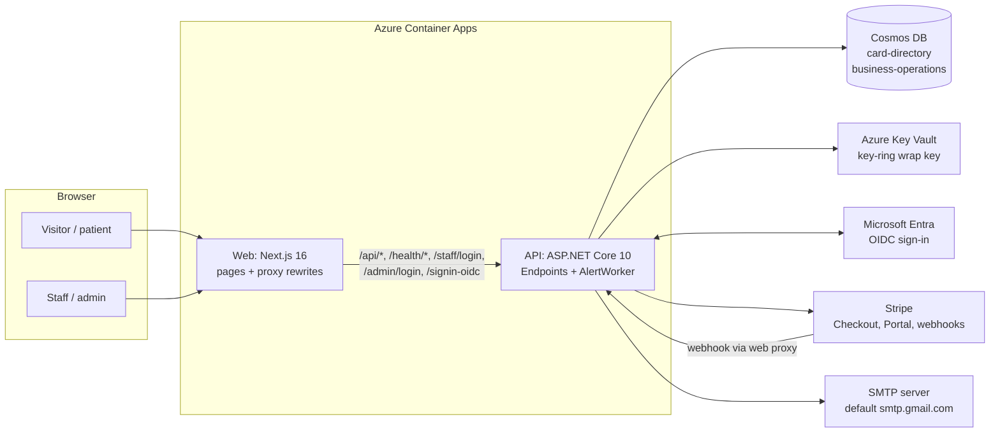
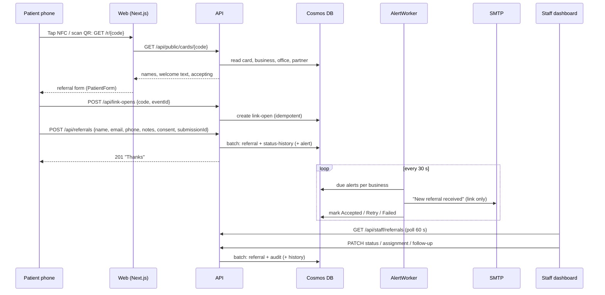
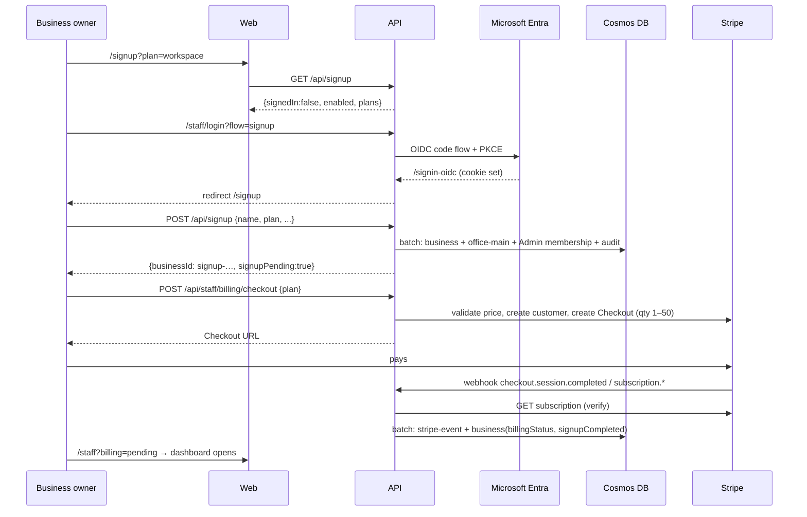
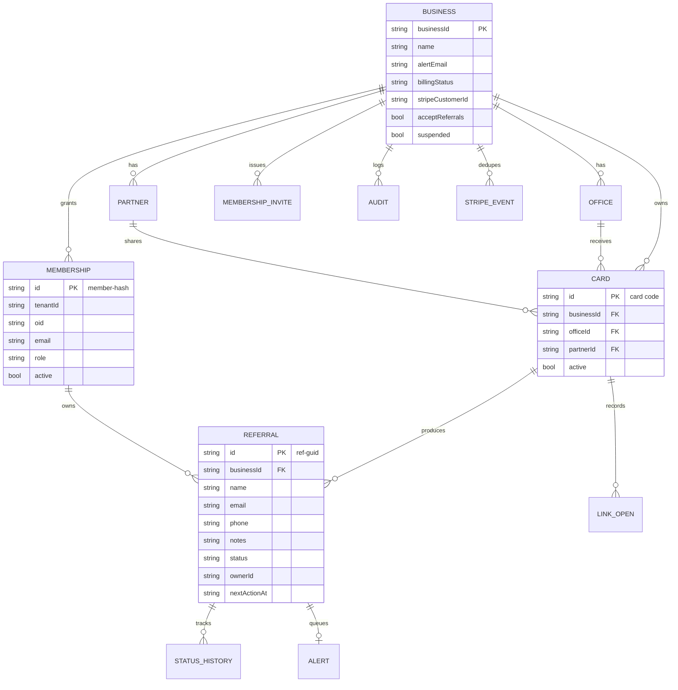

> **Current audit verification status — INCOMPLETE (2026-11-16).** The report below existed before this audit pass. Its conclusions, historical test results, deployment history, and completeness claims have NOT been independently revalidated in this pass. Do not treat it as a completed exhaustive audit or IIA conformance assurance.
>
> **Checkpoint:** Enumerated repository paths using `rg --files --hidden`, excluding the requested build/dependency directories and lock files. Read in full this pass: `src/bridgeway-web/AGENTS.md`, `src/BridgeWay.Api/Program.cs`, `src/BridgeWay.Api/TenantAuthorization.cs`, `src/BridgeWay.Api/Settings.cs`, `src/BridgeWay.Api/Requests.cs`, `src/BridgeWay.Api/BridgeWay.Api.csproj`, and `src/bridgeway-web/package.json`. Read only the opening of the prior report. Remaining files, binary assets, dependency currency, endpoint authorization coverage, accessibility, diagrams and inventory require verification.
>
> **Verified preliminary observations:** `Program.cs` configures an HttpOnly, Secure, SameSite=Lax staff cookie with one-hour non-sliding expiry; OIDC authorization-code flow with PKCE; production managed-identity Cosmos access and Key Vault protection of the cookie key ring. These controls do not establish referral-field encryption or live Azure settings. `TenantAuthorization.IsActiveMembershipFor` compares active status, business ID, tenant ID and object ID; call-site coverage remains unverified. `Submission.Validate` accepts names, email, phone and notes with consent and length/format checks. `Settings` provides Microsoft authority configuration and platform-admin tenant/object-ID checks. Actual deployment configuration is an INFORMATION GAP.
>
> **Preservation:** Existing staged logo asset was observed and left unchanged. No builds, tests, installations, deployments or external writes were performed in this pass. Only this report was edited, to record the incomplete verification status.

---
# BridgeWay (bridgewayrefer.com) — Internal Audit Report

**Audit date:** 2026-11-16 · **Commit audited:** `main` @ `61b1e4b` (merge of PR #38, mobile signup + dashboard redesign) · **Type:** read-only code audit (IIA 5-part observation format)

---

## 1. Executive Summary

**Overall rating: NEEDS IMPROVEMENT**

BridgeWay is a small, coherent two-service application: a Next.js 16 website and dashboards in front of an ASP.NET Core 10 API, storing everything in Azure Cosmos DB, with Microsoft Entra sign-in and Stripe subscriptions. The engineering fundamentals are better than typical for a product at this stage: tenant isolation is enforced server-side on every staff request, writes use optimistic concurrency and transactional batches, Stripe webhooks are signature-verified and idempotent, alert emails deliberately contain no referral details, and production start-up refuses unsafe configuration.

The rating is held down by five things:

1. **Healthcare data without the supporting controls (High).** Patient name, email, phone and free-text notes are stored indefinitely with no retention, deletion or export function, no BAA, and no application-level encryption. The site's own Security and Terms pages say this is not resolved.
2. **Invitation claiming relies on an email claim (High, conditional).** If multi-tenant Microsoft sign-in is enabled, a workspace invitation can be claimed by whoever presents a matching `email` claim, with no secret in the invite link.
3. **The deployment pipeline is unproven (Medium).** Every recorded run of the production deploy workflow failed, and the staged "candidate pair" smoke test does not test what it says it tests, because the web app's API address is fixed at build time.
4. **Per-location pricing is sold but not enforced or even recorded (Medium).** The marketing pages, the Terms page and the in-app Billing card disagree with each other.
5. **Unbounded growth and whole-history reads (Medium).** Every dashboard refresh writes an audit record that never expires, and analytics reads the workspace's entire history on each load.

Nothing found indicates a current breach or data loss. The items above are gaps to close before taking on more healthcare customers or relying on self-serve signup.

---

## 2. Methodology & Scope

**Scope.** Every tracked file on `main` (102 files excluding lock files and build output) was inspected. Read in full: all API source, scripts, workflows, docs, config, `lib/`, and every component and page that handles data, sign-in, forms or billing. Read in part: the four CSS files (structure and targeted searches, not line by line), the two industry marketing pages, and the test files (test names and the sections relevant to findings). Binary assets were checked for references only. A pattern search for committed secrets (Stripe keys, webhook secrets, connection strings, private keys, inline passwords) found none.

**Verification performed.**
- `gh pr checks 38`: CI `api` and `web` jobs passed on the merged PR.
- `gh run list --workflow deploy-production.yml`: last six runs all `failure`.
- `.next/routes-manifest.json` inspected to confirm rewrite destinations are baked at build time.
- `npm outdated` and `npm audit --omit=dev` run for the web app (0 known vulnerabilities).
- Earlier in this session: `npm run build` and 15/15 Playwright tests passed locally; 51 of 53 .NET tests passed locally, 2 failed locally but pass in CI.

**Limitations and information gaps.** These could not be determined from the repository and are marked INFORMATION GAP where they matter:

| Gap | Why it matters |
|---|---|
| Live Azure configuration (Container Apps settings, secrets, ingress, replicas, revision mode) | Cannot confirm what is deployed, whether `MultiTenantSignIn`, `CustomerSignupEnabled`, `AcceptReferrals` or `AlertsEnabled` are on, or whether the API is reachable directly from the internet |
| Cosmos DB account settings (encryption keys, backup policy, network rules, region) | Encryption at rest and backup are platform settings, not code |
| Entra app registration (single or multi-tenant, optional claims, unverified-email setting) | Decides whether finding N1 is exploitable |
| Stripe account (whether Prices are per-unit, portal settings) | Decides whether per-location checkout works |
| SMTP provider actually used | Default in code is `smtp.gmail.com` |
| What version of the code is live on bridgewayrefer.com | All recorded deploy runs failed; the external review may describe older code |
| .NET package currency | `dotnet list package --outdated` not run (a running API process locked the build output) |
| Colour contrast ratios | Not measured; needs a rendered-page tool |
| Whether GitHub `production` environment has required reviewers | Not visible from the repo |

**Working-tree notes.** `main` has one staged, uncommitted file: `src/bridgeway-web/app/BridgeWayRefer Suspension Bridge Logo.png` (1.06 MB). The branch `mobile-signup-dashboards` has two logo commits (`99b1668`, `69b2bfe`) that were pushed after PR #38 merged, so they are **not on `main`**. `main` still uses the old `brand-mark.png` icon.

---

## 3. Key Findings Table

Website findings are W1–W6; new code findings are N1–N20.

| # | Finding | Risk | Summary | Owner / Action |
|---|---|---|---|---|
| W1 | Healthcare data handling undisclosed, no BAA | **High** | Confirmed. PII stored indefinitely in Cosmos; no deletion, export, field encryption or disclosed subprocessors | Owner + counsel: decide HIPAA position; Dev: retention and deletion |
| N1 | Invites claimed by email claim alone | **High** (if multi-tenant sign-in is on) | No secret in invite link; any sign-in presenting the invited email gets the role | Dev: bind invites to a single-use token; check Entra settings this week |
| N2 | No retention or deletion for referrals and audit records | **High** | Only demo requests, Stripe events and rate buckets expire | Dev: retention policy + TTL + delete/export endpoints |
| N3 | Production deploy pipeline unproven | Medium | Last six deploy runs failed; deploy does not require passing tests | Dev: get one green run; gate on Verify |
| N4 | Candidate smoke test does not test the candidate API | Medium | Rewrites are fixed at build time to `http://bridgeway-api` | Dev: fix script or make proxy runtime-configurable |
| N5 | Per-location pricing not enforced or recorded | Medium | Quantity chosen at Checkout is never stored; locations are unlimited | Owner: decide rule; Dev: store quantity, cap locations |
| N6 | Pricing and card copy contradict each other | Medium | Terms page and in-app Billing still say "per business" and "cards separate" | Owner: approve wording; Dev: fix 4 places |
| N7 | Audit records written on every poll, never expire | Medium | One record per dashboard refresh (every 60 s per open tab) | Dev: stop auditing polls or add TTL |
| N8 | Analytics and history read entire workspace history | Medium | Cost and latency grow with every referral and tap | Dev: date-bounded queries |
| N9 | Rate limiting may key on the proxy's IP, not the visitor's | Medium (verify) | `X-Forwarded-For` only trusted from loopback by default | Dev: test in production; set known proxies |
| N10 | "Get the checklist" form promises an email that is never sent | Medium | Request is stored as a demo request only | Owner: send it manually or remove the form |
| W3 | `/signup` shows "Loading…" until JavaScript runs | Medium | Confirmed: client-side fetch in `SignupForm` | Dev: server-render initial state |
| W4 | Accessibility gaps | Medium | Partly refuted, partly confirmed, new items found | Dev: fix list in section 4 |
| W5 | Microsoft-only sign-in | Medium | Confirmed; identity is keyed on Microsoft `tid` + `oid` | Owner: decide; Entra External ID is the cheapest route |
| W2 | No social proof; hero claim unsourced | Medium | Confirmed; copy lives in `LandingPage.tsx` | Owner: supply proof or soften claim |
| N11 | Content Security Policy is minimal; any HTTPS logo URL allowed on patient form | Low–Medium | No `default-src`/`script-src`/`img-src` | Dev: tighten CSP; host logos |
| N12 | Staff session is a fixed 1 hour, no renewal | Low | Staff are signed out mid-work | Dev: sliding expiration with a cap |
| N13 | `Cache-Control: no-store` on every route | Low | Marketing pages are never cached | Dev: scope to private routes |
| N14 | Dead and legacy code and assets | Low | Unused component, fonts, image, types, CSS; "doctor" naming | Dev: clean-up |
| N15 | Invitation and onboarding emails are manual | Low | Admin must copy a link and send it themselves | Dev: send invite email |
| N16 | Containers run as root; API is a single replica | Low | No `USER` in Dockerfiles; `--min-replicas 1 --max-replicas 1` | Dev: non-root user; document single-replica reason |
| N17 | Card issuing is not atomic | Low | Up to 50 separate writes; partial result on failure | Dev: accept or add retry reporting |
| N18 | Two API tests fail locally but pass in CI | Low | Likely local user-secrets leaking into tests | Dev: isolate test configuration |
| N19 | Hard-coded Mountain Time | Low | Reports and timestamps assume `America/Denver` | Dev: per-business time zone |
| N20 | No infrastructure-as-code; docs partly stale | Low | Azure resources are hand-made; README cites a missing `UiDesign` folder | Dev: Bicep/Terraform; refresh docs |
| W6 | Repeated "Tap → Scan → Refer" strip, duplicate nav | Low | Mostly refuted: strip is `aria-hidden`; duplicate nav is not rendered | One new related item (hidden comparison content) |

---

## 4. Detailed Observations

### Part A — External website findings verified against the code

#### W1. Healthcare data (HIGH) — CONFIRMED

| | |
|---|---|
| **Condition** | The public form (`components/PatientForm.tsx`) collects first name, last name, email, phone, optional request type, postal code and up to 2,000 characters of notes. `POST /api/referrals` (`Endpoints.cs:78-109`) stores them as a `referral` document in the Cosmos container `business-operations`, partitioned by `businessId`. There is no application-level encryption of these fields, no TTL on referral documents, and no endpoint that deletes or exports a referral. `/security` and `/terms` state there is no HIPAA certification and no BAA. |
| **Criteria** | HIPAA Privacy and Security Rules where the customer is a covered entity (dental and orthodontic practices are); general privacy practice: disclose storage, retention and subprocessors, and honour deletion requests. |
| **Cause** | The product was built as a general referral tool and marketed to dental practices first (`docs/pilot-readiness.md`); compliance decisions were deferred (`app/privacy/page.tsx`: "retention, deletion, and healthcare contractual requirements should be confirmed before deployment"). |
| **Effect** | A dental customer using this for patient referrals is likely placing PHI with a vendor that has no BAA. Regulatory exposure sits with both the practice and BridgeWay. |
| **Recommendation** | 1) Decide with counsel whether BridgeWay will act as a business associate. 2) If yes: sign a Microsoft BAA (covers Azure), choose an SMTP provider that signs one, publish a subprocessor list, offer a BAA. 3) Build retention, deletion and export (N2). 4) Until then, do not market to covered entities as ready for patient data. |
| **Risk** | High: regulated data, explicit absence of the required agreement, and no ability to delete. |

**Evidence detail requested by the review:**

- **Where stored:** Azure Cosmos DB, database from `Cosmos:Database`, container `business-operations` (`CosmosStore.cs:18`). Development account name in scripts is `bridgeway-dev-nosql`. Production account and region: INFORMATION GAP.
- **Encryption at rest:** nothing in code. Cosmos DB encrypts at rest by default with Microsoft-managed keys (platform behaviour, not verified against this account). Customer-managed keys: INFORMATION GAP. The cookie key ring stored in Cosmos *is* wrapped with Azure Key Vault in production (`Program.cs:46-53`).
- **Encryption in transit:** HTTPS enforced for the Cosmos endpoint (`Program.cs:38`), `PublicOrigin` must be HTTPS in production (`Program.cs:22`), SMTP uses implicit TLS or STARTTLS (`AlertWorker.cs:74`). Web-to-API traffic inside Azure uses `http://bridgeway-api` (`src/bridgeway-web/Dockerfile:7`); whether that hop is encrypted depends on the Container Apps environment: INFORMATION GAP.
- **Retention/deletion:** none for `referral`, `status-history`, `link-open`, `alert`, `audit`, `membership`, `business`. TTLs exist only for `rate` (2 h), `billing-checkout-lock` (1 day), `demo-request` and `stripe-event` (90 days). The only delete code is `PurgeDemoData` (`CosmosStore.cs:152`), which targets demo and test partitions.
- **Audit logging:** partial. `audit` documents are written for writes (status, assignment, follow-up, profile, partners, offices, invites, cards, signup) and for two reads (`list-referrals`, `monthly-referral-counts`). Not audited: viewing one referral's history, platform-admin reads, and public submissions. Nothing in the product reads the audit records back, and they record the actor's Entra object ID, not a name.
- **Third parties that receive referral data:** only Microsoft Azure (Cosmos DB). Checked and excluded: the alert email contains a dashboard link only (`AlertWorker.cs:72`); Stripe receives the business name and ID only (`StripeBillingService.cs:62,75-81`); Microsoft Entra receives staff identity only; no analytics or tracking scripts exist; fonts are self-hosted by `next/font`. One indirect exposure: if a business sets a `logoUrl` on another host, each patient's browser fetches that image, revealing IP address and user agent to that host (N11).

#### W2. No social proof; hero claim unsourced (MEDIUM) — CONFIRMED

| | |
|---|---|
| **Condition** | The hero headline "Most partner referrals never get followed up. Yours will." has no source. There are no testimonials, logos or case studies. The "referral math" section is labelled "Illustrative example". |
| **Criteria** | Marketing claims should be supportable (FTC truth-in-advertising); B2B buyers expect evidence. |
| **Cause** | Pre-launch product without customers to cite. |
| **Effect** | Lower conversion and a minor substantiation risk. |
| **Recommendation** | Soften to a claim about the product ("Give every partner referral an owner") or cite a source. Add proof when a pilot allows. |
| **Risk** | Medium (commercial). |

**Where the copy lives:** hero and all landing sections in `components/LandingPage.tsx` (constants `PIPE_STEPS`, `FEATURES`, `FAQS` at the top; hero JSX around line 420; pricing around 700). The same FAQ text is duplicated for search engines in `app/page.tsx` (`faqSchema`) and must be edited in both. Other pages: `app/pricing/page.tsx`, `app/contact/page.tsx`, `app/industries/dental/page.tsx`, `app/industries/trades/page.tsx`, `app/signup/page.tsx`, legal pages in `app/privacy|security|terms/page.tsx`. Site-wide description: `lib/site.ts`.

#### W3. `/signup` renders "Loading…" until JavaScript runs (MEDIUM) — CONFIRMED

| | |
|---|---|
| **Condition** | `components/SignupForm.tsx` is a client component. It starts with `state` undefined and renders `Loading…` (line 55) until a `useEffect` fetch of `GET /api/signup` returns. `/signup` is statically prerendered, so the HTML always contains "Loading…". |
| **Criteria** | Primary conversion pages should render meaningful content without waiting for a client round trip. |
| **Cause** | The page needs two runtime facts (is signup enabled; is the visitor signed in), and they are fetched in the browser. |
| **Effect** | Flash of "Loading…", nothing for no-JS clients and crawlers, slower perceived load on the page every CTA now points to. |
| **Recommendation** | Server rendering is feasible. Make `app/signup/page.tsx` an async server component that calls the API's `/api/signup` server-side, forwarding the request cookie (the same pattern `PublicPage.tsx` already uses for cards), and pass the result to `SignupForm` as initial state. Cheaper alternative: render the plan chooser and "Continue with Microsoft" immediately and only gate the final form on the fetch. |
| **Risk** | Medium, because PR #38 made this the main entry point. |

#### W4. Accessibility (MEDIUM) — PARTLY REFUTED, PARTLY CONFIRMED, NEW ITEMS

| Claim | Verdict | Evidence |
|---|---|---|
| Logo has empty alt text | **Refuted as a defect.** | `Header.tsx:26`, `LandingPage.tsx:373`: the image is decorative (`alt=""`), sits beside the visible text "BridgeWay", and the link has `aria-label="BridgeWay home"`. This is the correct WCAG pattern. (The unmerged logo branch uses `alt="BridgeWay"` on a wordmark image, also correct.) |
| ☰ mobile menu has no aria-label | **Fixed on `main`.** | `Header.tsx:31` and `LandingPage.tsx` menu button: `aria-label` "Open menu"/"Close menu", `aria-expanded`, `aria-controls`. Before PR #38 there was no mobile menu at all. If the live site still shows the old behaviour, it has not been redeployed (see N3). |
| Form labels unverified | **Verified: all inputs have programmatic labels.** | See table below. |

Form-by-form check (WCAG 2.1 AA: 1.3.1, 3.3.2, 4.1.2):

| Form | File | Labels | Issues |
|---|---|---|---|
| Public referral form | `PatientForm.tsx` | `label htmlFor` on every field; error in `role="alert"`; success panel receives focus | Honeypot is `aria-hidden` with `tabIndex=-1` (acceptable). Required fields say "Required" in text (good). |
| Contact / walkthrough | `DemoRequestForm.tsx` | Wrapping `<label>`s | None |
| Landing lead forms | `LandingPage.tsx` ~790-860 | Visually hidden labels + placeholders | Forms use `noValidate`, so the browser does not flag empty fields; the server returns one generic message ("Please check the demo request form.") that does not say which field is wrong (3.3.1, 3.3.3). `.bw-lead-form input:focus { outline: none }` (`landing.css:551`) leaves only a border-colour change as the focus indicator (2.4.7, borderline). |
| Signup | `SignupForm.tsx` | Wrapping labels, `fieldset`/`legend` for plan | None |
| Follow-up editor | `FollowUpEditor.tsx` | Wrapping labels | None |
| Staff dashboard forms | `StaffDashboard.tsx` | `htmlFor` on all | Status `<select>` saves immediately on change with no undo; revoke uses `window.confirm` |
| Admin console forms | `AdminConsole.tsx` | `htmlFor` on all; search and filter have hidden labels | Tabs are buttons with `aria-current="page"` rather than `role="tab"`; workable but not the standard pattern |

New accessibility findings:

1. **Meaningful content hidden from screen readers.** `LandingPage.tsx:645`: the "Without BridgeWay / With BridgeWay" comparison lists are inside `aria-hidden="true"`. That is real content, not decoration (1.3.1). Remove `aria-hidden`.
2. **Off-screen staff navigation remains focusable on phones.** The slide-in sidebar is moved off-screen with a CSS transform only (`staff.css` ≤760px); its links stay in the tab order, there is no focus trap and focus does not return to the toggle on close (2.4.3, 2.4.7).
3. **Header and footer nested inside `<main>` on the home page** (`LandingPage.tsx:360`), while the layout's own header and footer are hidden with CSS. Landmarks are less useful (1.3.1, low).
4. **Colour contrast not verified**: INFORMATION GAP. Candidates to measure: the tan eyebrow text on the pale background, muted grey hints, light-blue "Refer" style accents.
5. **SVG trend chart** has a title and a data table alternative (good).

#### W5. Microsoft-only staff sign-in (MEDIUM) — CONFIRMED

| | |
|---|---|
| **Condition** | The only sign-in scheme is OpenID Connect against Microsoft (`Program.cs:67-86`). Identity everywhere is the pair of Microsoft claims `tid` (tenant) and `oid` (object ID): `RequireIdentity` (`Endpoints.cs:46`), the staff filter (`Endpoints.cs:187`), `MembershipId` = SHA-256 of `tid:oid` (`CosmosStore.cs:72`), `Settings.AcceptsTenant` (GUID tenant only), and the issuer validator that accepts only `login.microsoftonline.com`. The CSP `form-action` allows only Microsoft hosts (`next.config.ts:15`). |
| **Criteria** | Sign-in should not exclude the target market; many small dental and trades businesses use Google Workspace or plain email. |
| **Cause** | Built first for a single workforce tenant, then extended with a `MultiTenantSignIn` flag. |
| **Effect** | Prospects without a Microsoft account cannot sign up or accept an invite. |
| **Recommendation** | Two routes. **(a) Entra External ID** (lowest effort): the `Authority` setting already supports a `ciamlogin.com` tenant, which can offer Google and email one-time-passcode sign-in. Mostly configuration plus testing; code impact is small because External ID still issues `tid` and `oid`. Estimate: a few days including Entra setup and regression tests. **(b) Native Google or email sign-in**: requires replacing `tid`+`oid` with a provider-neutral identity (provider + subject), migrating membership IDs, a second auth handler, and for email a magic-link sender. Estimate: one to two weeks plus migration risk. |
| **Risk** | Medium (commercial, not security). |

#### W6. Repeated "Tap → Scan → Refer" strip and duplicate navigation (LOW) — MOSTLY REFUTED

- The marquee (`LandingPage.tsx:685`) is `aria-hidden="true"`, so the repeated text is not announced. The landing stylesheet disables all animation under `prefers-reduced-motion` (`landing.css`, final block).
- Duplicate navigation: the mobile menu is only rendered while open (`{menuOpen && <nav …>}`), and the desktop nav is `display:none` below 860px, so assistive technology sees one navigation at a time. The two navs have different labels ("Main navigation", "Mobile navigation").
- The hero mock-up is `aria-hidden` and its fake button has `tabIndex=-1` (correct).
- Related real issue: the comparison lists are wrongly hidden (W4, new item 1).

---

### Part B — New findings

#### N1. Workspace invitations can be claimed by email claim alone (HIGH, conditional)

| | |
|---|---|
| **Condition** | An invitation is a `membership-invite` document holding an email and role. The invite link is `/staff/login?workspace=<businessId>` and contains no secret (`Endpoints.cs:306`, `AdminEndpoints.cs:93,145`). On any staff request, the filter reads the signed-in user's `email` claim (falling back to `preferred_username`) and, if a pending invite matches that email, creates an active membership (`Endpoints.cs:189-212`, `AcceptInvite` at 26-44). If the user has no memberships and exactly one pending invite matches their email, it is accepted without the caller even supplying a workspace ID (lines 192-196 and 204-212). |
| **Criteria** | Authorization should be bound to a verified identifier or to a secret only the invitee holds. Microsoft documents that the `email` claim can be unverified for multi-tenant applications and must not be used for authorization. |
| **Cause** | Invites were designed for a single workforce tenant, where the tenant administrator controls every email value. `MultiTenantSignIn` (`Settings.cs:63`) later opened sign-in to any tenant and personal accounts without changing how invites are matched. |
| **Effect** | With multi-tenant sign-in on, a person who controls a Microsoft tenant and knows or guesses an invited address (for example the admin email of a newly created business, valid for 14 days) could sign in presenting that address and receive that role, including Admin, with access to all referral records for the business. |
| **Recommendation** | Add a random single-use token to each invite, put it in the link, and require it at acceptance. Stop auto-accepting on email alone. Additionally require a verified-email signal (`xms_edov`) or restrict to `preferred_username` from the home tenant. This week: confirm whether `Bridgewayrefer__MultiTenantSignIn` is `true` in production and whether the Entra app registration removes unverified email claims. |
| **Risk** | High if multi-tenant sign-in is enabled (INFORMATION GAP); Low in single-tenant mode. Self-serve signup for outside customers requires multi-tenant or External ID, so this must be closed before signup is opened. |

#### N2. No retention or deletion for customer and audit data (HIGH)

| | |
|---|---|
| **Condition** | See W1 evidence. Referral, history, link-open, alert, audit and membership documents never expire. No API or UI deletes or exports a referral or a whole business. Cancelling a subscription only stops new intake (`BusinessRules.AcceptsReferrals`). |
| **Criteria** | Data minimisation; ability to honour deletion requests and customer off-boarding; HIPAA disposal requirements where applicable. |
| **Cause** | Not yet built; the privacy page defers it. |
| **Effect** | PII accumulates forever, including for churned customers. A deletion request can only be met by hand in the Azure portal. |
| **Recommendation** | Define retention per record type. Add: delete-referral (admin), export-referrals (CSV), close-workspace (purge partition and cards). Set a TTL on `audit` and `link-open` records. |
| **Risk** | High in combination with W1. |

#### N3. Production deployment pipeline is unproven (MEDIUM)

| | |
|---|---|
| **Condition** | The six most recent runs of `Deploy production` all ended in `failure` (several at 0 s, on `push` triggers from earlier versions of the workflow). The current workflow is manual-only. It does not check that the `Verify` workflow passed for the commit, and `Verify` runs only on pull requests, not on `main`. No infrastructure-as-code exists in the repo. |
| **Criteria** | A release process should be repeatable, gated on tests, and have at least one demonstrated success. |
| **Cause** | The workflow was rewritten several times on 2026-11-16 (branches `codex/fix-acr-*`, `codex/revert-deployment-workflow`). |
| **Effect** | Unknown what code is live (INFORMATION GAP). The external review may have audited a build older than `main`. A failed or manual deploy path increases the chance of configuration drift. |
| **Recommendation** | Run the workflow once end to end and record the result. Add a required-status check or a `workflow_run` dependency on Verify. Add required reviewers to the `production` environment. Capture the Azure resources in Bicep or Terraform. |
| **Risk** | Medium. |

#### N4. The staged "candidate pair" smoke test does not exercise the candidate API (MEDIUM)

| | |
|---|---|
| **Condition** | `scripts/deploy-production.sh` stages a new API revision, then starts the new web revision with `--set-env-vars BRIDGEWAY_API_ORIGIN=https://<candidate API>` and smoke-tests `/health/cosmos` through the web candidate. But `next.config.ts` computes its rewrites from that variable **at build time**; they are written into `.next/routes-manifest.json` (verified locally: destinations are literal URLs). The image is built with the Dockerfile default `http://bridgeway-api`. So `/api/*`, `/health/*` and the sign-in routes on the candidate web always go to whatever API revision is currently serving. Only the server-side card lookup in `PublicPage.tsx` reads the variable at run time. |
| **Criteria** | A pre-promotion test must exercise the thing being promoted. |
| **Cause** | Assumption that Next.js rewrites read environment variables at run time. |
| **Effect** | A broken API build can pass the candidate smoke test and be promoted; it is then caught only by the public smoke test after traffic has moved (the script does roll back at that point). Side effect: after promotion the web revision keeps a revision-specific API address in its environment for card lookups, so the web app and its own proxy can point at different API revisions after the next API-only change. |
| **Recommendation** | Smoke-test the API candidate directly on its own revision URL, and remove the per-revision env override; or move the proxy to a route handler/middleware that reads the origin at run time. |
| **Risk** | Medium: weakens the main safety net of the rollout, with a working rollback behind it. |

#### N5. Per-location pricing is not enforced or recorded (MEDIUM)

| | |
|---|---|
| **Condition** | PR #38 changed marketing to "$50 / location / month" and made the Checkout quantity adjustable from 1 to 50 (`StripeBillingService.cs:76-78`). The webhook (`StripeBillingEndpoints.cs:93-99`) stores the plan and a flat `monthlyPriceUsd`, never the quantity. `POST /api/staff/offices` (`Endpoints.cs:270`) lets an admin add unlimited locations. Changing quantity later in the Stripe portal is not reflected anywhere. |
| **Criteria** | What is sold should match what is billed and what the system allows. |
| **Cause** | Pricing model changed mid-task from a message during the redesign; only the Checkout call was updated. |
| **Effect** | A customer can pay for one location and use many. The in-app Billing card shows $50 regardless of quantity. Whether adjustable quantity works at all depends on the Stripe Price type: INFORMATION GAP. |
| **Recommendation** | Decide the rule (honour system, hard cap, or auto-sync). Minimum: read `items.data[0].quantity` in the webhook, store it as `paidLocations`, show it in Billing, and block or warn when active offices exceed it. |
| **Risk** | Medium (revenue leakage and customer confusion; no security impact). |

#### N6. Pricing and NFC-card statements contradict each other (MEDIUM)

| | |
|---|---|
| **Condition** | After PR #38: landing, pricing and signup pages say per location and "NFC cards included". Still saying otherwise: `app/terms/page.tsx` ("$50 USD per business per month. Physical NFC cards and fulfillment are separate"); `StaffDashboard.tsx` Billing card ("Workspace / business / month", "Workspace - $50/month", "Managed Calling, total per business / month"); setup step 1 is still titled "Confirm workspace access" although it is about billing; `README.md` describes per-business pricing. The alert email subject is "New referral received - Bridgewayrefer" and its body says "Patient details" for every industry (`AlertWorker.cs:70-72`). |
| **Criteria** | Terms and in-product billing text must agree with advertised pricing. |
| **Cause** | Copy edit in PR #38 did not cover the Terms page or the Billing card. |
| **Effect** | The Terms page is the contractual statement and currently contradicts the offer. |
| **Recommendation** | Fix the four places listed; have the owner approve the Terms wording. |
| **Risk** | Medium (contractual clarity). |

#### N7. Audit records are written on every dashboard poll and never expire (MEDIUM)

| | |
|---|---|
| **Condition** | `GET /api/staff/referrals` writes an `audit` document on every call (`Endpoints.cs:356`); `GET /api/staff/analytics` does the same (line 428). The dashboard calls the referrals endpoint on load, every 60 seconds while visible, and on focus (`StaffDashboard.tsx` `refresh`). Audit documents have no TTL. |
| **Criteria** | Audit logs should record meaningful access, be bounded, and be reviewable. |
| **Cause** | Read-auditing was attached to the list endpoint, which is also the polling endpoint. |
| **Effect** | Roughly 1,400 audit writes per day per open dashboard tab, indefinitely, on a container provisioned at 400 RU/s (`Initialize-Cosmos.ps1`). The signal (who viewed what) is buried in poll noise, and nothing reads the log anyway. |
| **Recommendation** | Audit at most once per session or per search, add a TTL, and add an admin view or export of the audit trail. |
| **Risk** | Medium (cost, throttling risk, and an audit trail that is not usable as evidence). |

#### N8. Analytics and history endpoints read the entire workspace history (MEDIUM)

| | |
|---|---|
| **Condition** | `/api/staff/analytics` loads every referral summary, link-open and status-history document for the business on each request (`Endpoints.cs:429`), acknowledged in `docs/reporting-semantics.md`. `/api/staff/referrals/{id}/history` loads all status history for the business and filters in memory (line 406). The admin business detail does the same for opens and referrals (`AdminEndpoints.cs:102-103`). `AlertWorker` lists all businesses across partitions every 30 seconds. |
| **Criteria** | Query cost should scale with the page shown, not total history. |
| **Cause** | Simplest correct implementation for a small pilot. |
| **Effect** | Latency and request-unit cost grow with every tap and referral; at 400 RU/s this will produce 429 throttling for active workspaces. |
| **Recommendation** | Filter history by `referralId` in the query. Bound analytics to the 12-month window plus a small monthly summary document. |
| **Risk** | Medium (scales into an outage, not a breach). |

#### N9. Rate limiting may not see the visitor's real IP address (MEDIUM, needs production check)

| | |
|---|---|
| **Condition** | Public rate limits hash `Connection.RemoteIpAddress` (`Endpoints.cs:17`): 10 referrals, 5 demo requests and 300 link-opens per address per hour. `Program.cs:57` enables `X-Forwarded-For` with `ForwardLimit = 1` but sets no known proxies or networks; ASP.NET Core then trusts the header only when the immediate peer is loopback. All browser traffic reaches the API through the Next.js rewrite proxy in a different container. |
| **Criteria** | Per-client throttles must key on the client. |
| **Cause** | Default forwarded-header trust settings. |
| **Effect** | Most likely the API sees one address (the web app or ingress) for everyone, so the limit becomes 10 referrals per hour per business in total, blocking real patients on a busy day while giving no per-attacker protection. Actual behaviour depends on the Container Apps network path: INFORMATION GAP. |
| **Recommendation** | Log the hashed address for a few test submissions from different networks. Configure `KnownNetworks`/`KnownProxies` for the environment and the correct `ForwardLimit` (two hops: ingress and Next.js). |
| **Risk** | Medium (availability of the core intake path). |

#### N10. The checklist form promises an email that the system never sends (MEDIUM)

| | |
|---|---|
| **Condition** | The landing page's second lead form says "Get the checklist" and, on success, "Check your inbox for the checklist." (`LandingPage.tsx`). `submitChecklist` posts to `/api/demo-requests` with the business name "Referral follow-up checklist request"; the API only stores a `demo-request` document (`Endpoints.cs:59-69`). No code sends an email to a visitor. The consent text says "One email with the checklist, nothing else." |
| **Criteria** | Do what the page says; consent statements must be accurate. |
| **Cause** | Marketing form added without a fulfilment step. |
| **Effect** | Visitors are told to expect an email that does not arrive unless someone sends it by hand from the admin "Demo requests" tab. |
| **Recommendation** | Fulfil manually and change the success text to "We'll email it within one business day", or automate the send, or remove the form. |
| **Risk** | Medium (trust and accuracy of a consent statement). |

#### N11. Minimal Content Security Policy; arbitrary HTTPS logo on the patient form (LOW–MEDIUM)

| | |
|---|---|
| **Condition** | CSP is `frame-ancestors 'none'; base-uri 'self'; form-action …; object-src 'none'` (`next.config.ts:15`). No `default-src`, `script-src`, `img-src` or `connect-src`. A business admin can set `logoUrl` to any `https://` address (`Endpoints.cs:262`), which is rendered as an `` on the public form. HSTS has no `includeSubDomains`. |
| **Criteria** | Defence in depth against script injection; avoid third-party requests from pages where patients enter data. |
| **Cause** | Headers cover clickjacking and form posting only. |
| **Effect** | No CSP backstop if an XSS bug is introduced (React escaping is the only layer; no `dangerouslySetInnerHTML` with user data was found). Third-party logo hosts learn patients' IP addresses. |
| **Recommendation** | Add a nonce-based `script-src`, `default-src 'self'`, `img-src 'self' data:` plus an upload or allow-list for logos. |
| **Risk** | Low–Medium. |

#### N12–N20 (LOW) — condensed

| # | Condition | Criteria | Cause | Effect | Recommendation |
|---|---|---|---|---|---|
| N12 | Session cookie lasts exactly 1 hour, `SlidingExpiration = false` (`Program.cs:63`) | Sessions should end on inactivity, not mid-task | Conservative default | Staff are signed out during the day; unsaved follow-up text is lost | Sliding expiry with an absolute cap (for example 8 hours) |
| N13 | `Cache-Control: no-store` is applied to `/:path*` (`next.config.ts:14`) and by the API middleware | Cache public content; never cache private | One rule for everything | Marketing pages are re-downloaded every visit. Effect on `_next/static` assets: INFORMATION GAP (Next.js may override) | Apply `no-store` only to `/staff`, `/admin`, `/r`, `/signup`, `/api` |
| N14 | Dead or legacy items: `components/ManagedCallingForm.tsx` (nothing imports it); `public/fonts/Lato-*.ttf` (1.3 MB, unreferenced); `public/brand-logo.png` (unreferenced); `Doctor` type in `lib/api.ts`; `doctorCode`/`doctorName` field names throughout; tests mock `/api/staff/doctors`, which does not exist; CSS classes `.doctor`, `.referral`, `.toolbar` and triplicated button rules in `staff.css`; duplicated pricing-grid rules across `site.css` and `landing.css`; `docs/bridgeway-cosmos-starter.md` is a stub; 1 MB logo PNG staged inside `app/` | Remove unused code | Several redesigns layered on a migration from Flask | Larger images, slower onboarding, risk of editing the wrong rule | Delete the listed items; plan a rename of `doctor*` fields with a data migration |
| N15 | Creating an invite only returns a link; no email is sent (`Endpoints.cs:299-307`) | Onboarding should not depend on manual copy-paste | Email is used for alerts only | Slower onboarding; links shared over chat | Send the invite by email (combine with N1's token) |
| N16 | Neither Dockerfile sets a non-root `USER`; deploy pins the API to one replica so only one alert worker runs | Least privilege; availability | Defaults; worker runs in-process | Container compromise has root in the container; an API restart is a brief outage | Add `USER`; move the worker to a separate job if scaling out |
| N17 | Issuing N cards performs N separate audit and card writes across two containers (`AdminEndpoints.cs:172-185`) | Multi-step writes should be atomic or resumable | Cards live in a different partition per card | A failure mid-loop leaves some cards issued and returns an error with no list | Return partial results, or make the request idempotent |
| N18 | `ParityTests.SignupRequiresAuthenticationAndAnEnabledCheckout` and `PlatformAdminConsoleRejectsEveryoneButConfiguredAdmins` fail on this workstation and pass in CI | Tests should be hermetic | Probable cause (not verified): developer user-secrets are loaded in the test host's Development environment | Local red tests get ignored | Force a clean configuration in the test factory |
| N19 | `MonthlyReport.cs:8` and dashboard timestamps hard-code `America/Denver` | Reports should use the customer's time zone | First customers are in Mountain Time | Month boundaries are wrong for other regions | Store a time zone per business |
| N20 | No IaC; `README.md` references a `UiDesign` folder that does not exist and a different repo name; `docs/pilot-readiness.md` lists items since built | Docs and infrastructure should be reproducible | Fast iteration | Rebuild-from-scratch is manual; new contributors are misled | Add Bicep/Terraform; refresh README |

**Controls found working (positive observations).** Server-side tenant check on every `/api/staff/*` call with no fallback to another business; ETag concurrency on all updates; transactional batches for referral + history + alert; Stripe webhook HMAC verification with a 5-minute window and constant-time compare; webhook cross-checks live/test mode, customer and business before changing billing; origin and JSON content-type checks on every write as CSRF protection; HttpOnly, Secure, SameSite=Lax cookie; PKCE; production start-up fails without HTTPS origin, identity, platform admin, named database and Key Vault key; managed identity required for Cosmos outside Development; errors and logs suppress record contents; alert emails carry no referral data; honeypot and idempotency keys on public forms; `noindex` on private routes; no secrets in the repository; 0 known npm vulnerabilities.

---

## 5. File Inventory

Status key: **Active** (used in the running product), **Legacy** (kept for compatibility or history), **Dead** (nothing uses it), **Unsure**.

### Repository root

| Path | Purpose | Depends on / used by | Status |
|---|---|---|---|
| `README.md` | Setup, usage and production settings | Humans | Active, partly stale (N20) |
| `.gitignore` | Ignore rules; still lists Python-era entries (`.venv/`, `__pycache__/`, `*.sqlite3`) | Git | Active; Python lines are Legacy |
| `.dockerignore` | Keeps secrets and build output out of images | Both Dockerfiles | Active |
| `AUDIT_REPORT.md` | This report | — | Active |

### `.github/workflows/`

| Path | Purpose | Depends on / used by | Status |
|---|---|---|---|
| `verify.yml` | CI on pull requests: `dotnet test`, web build, Playwright | Tests | Active |
| `deploy-production.yml` | Manual deploy: build images in ACR, run rollout script | `scripts/deploy-production.sh`, GitHub `vars` | Active, never seen green (N3) |

### `scripts/`

| Path | Purpose | Depends on / used by | Status |
|---|---|---|---|
| `deploy-production.sh` | Staged rollout on Azure Container Apps with rollback | Azure CLI; called by deploy workflow | Active (N4) |
| `Initialize-Cosmos.ps1` | Creates the database and two containers within the free-tier allowance | Azure CLI | Active (dev) |
| `Start-Local.ps1` | Starts API and web locally | .NET, npm | Active (dev) |

### `docs/`

| Path | Purpose | Status |
|---|---|---|
| `activation-workflow.md` | Describes the six-step setup checklist and test-referral design | Active; "current limitation" paragraph is outdated (the UI now calls the test endpoint) |
| `bridgeway-cosmos-starter.md` | Three-line pointer to other docs | Dead (stub) |
| `migration.md` | Mapping from the old Flask/Table Storage app | Legacy reference |
| `pilot-readiness.md` | Pre-pilot checklist | Legacy; several items since built |
| `referral-tracking.md` | How link opens are counted | Active |
| `reporting-semantics.md` | Definitions of monthly metrics | Active |

### `src/BridgeWay.Api/`

| Path | Purpose | Depends on / used by | Status |
|---|---|---|---|
| `Program.cs` | Start-up: config validation, Cosmos client, cookie + OIDC auth, security middleware, login/logout routes, CLI commands | Everything | Active |
| `Settings.cs` | Typed settings; `BillingPlans`, `ApiError`, `BusinessRules` | All endpoints | Active |
| `Endpoints.cs` | Public endpoints, signup, and all `/api/staff/*` endpoints with the tenant filter | `CosmosStore`, `StripeBillingService`, rules classes | Active |
| `AdminEndpoints.cs` | `/api/admin/*` platform console endpoints | `CosmosStore`, `Settings.IsPlatformAdmin` | Active |
| `StripeBillingEndpoints.cs` | Stripe webhook handler and helpers | `StripeBillingService`, `CosmosStore` | Active |
| `StripeBillingService.cs` | Stripe REST calls and webhook signature check | `HttpClient`, `Settings` | Active |
| `CosmosStore.cs` | Data access, rate limiter, audit helper, demo purge | Cosmos SDK | Active; `PurgeDemoData` is a one-off tool |
| `CosmosXmlRepository.cs` | Stores the cookie key ring in Cosmos | Data Protection | Active |
| `AlertWorker.cs` | Background email sender with retries | MailKit, `CosmosStore` | Active |
| `MonthlyReport.cs` | Builds the monthly analytics response | Called by `/analytics` | Active |
| `ReferralSearch.cs` | Builds the parameterised inbox query | Called by `/referrals` | Active |
| `FollowUpRules.cs` | Validates follow-up dates; terminal statuses | Endpoints | Active |
| `TestReferralRules.cs` | Synthetic test referral creation | Endpoints | Active |
| `TenantAuthorization.cs` | Pure functions for membership and invite checks | Endpoints, tests | Active |
| `Requests.cs` | Request record types and `Submission.Validate` | Endpoints | Active; `CardUpdate` etc. all used |
| `LegacyImport.cs` | `--import` command for old Flask data | `Program.cs` CLI | Legacy |
| `appsettings.json` | Logging levels and container names | Config | Active |
| `BridgeWay.Api.csproj` | Packages: Azure.Identity 1.17.1, DataProtection.Keys 1.6.1, Cosmos 3.58.0, Newtonsoft.Json 13.0.4, OpenIdConnect 10.0.10, Cryptography.Xml 10.0.13, MailKit 4.18.2 | Build | Active; currency not checked (INFORMATION GAP) |
| `Dockerfile` | Multi-stage build on `aspnet:10.0` | Deploy | Active (N16) |
| `.gitignore` | Ignores `bin`, `obj` | Git | Active |

### `src/bridgeway-web/` (config and root)

| Path | Purpose | Status |
|---|---|---|
| `package.json` | next 16.4.5 (16.4.6 available), react 19.3.1, qrcode; dev: Playwright 1.65.0, TypeScript 5.9.3 (7.0.2 available), @types/node 24 | Active; only patch updates pending |
| `next.config.ts` | Standalone output, API rewrites, security headers | Active (N4, N11, N13) |
| `tsconfig.json`, `playwright.config.ts` | Tooling | Active |
| `Dockerfile` | Build and run on `node:24-alpine` | Active (N16) |
| `.env.example`, `.gitignore`, `AGENTS.md` | Example env, ignores, agent note auto-written by `next dev` | Active |

### `src/bridgeway-web/app/`

| Path | Purpose | Status |
|---|---|---|
| `layout.tsx` | Root layout, metadata, viewport, skip link, header, footer; imports all four stylesheets | Active |
| `page.tsx` | Home: metadata, JSON-LD (duplicates FAQ text), renders `LandingPage` | Active |
| `pricing/page.tsx`, `contact/page.tsx`, `industries/dental/page.tsx`, `industries/trades/page.tsx` | Marketing pages | Active |
| `signup/page.tsx` + `layout.tsx` | Signup shell (noindex) hosting `SignupForm` | Active (W3) |
| `sign-in/page.tsx` + `layout.tsx` | Staff sign-in landing | Active |
| `staff/page.tsx` + `layout.tsx` | Hosts `StaffDashboard` | Active |
| `admin/page.tsx` + `layout.tsx` | Hosts `AdminConsole` | Active |
| `r/[code]/page.tsx`, `r/[code]/not-found.tsx`, `r/layout.tsx` | Public card page | Active |
| `privacy/page.tsx`, `security/page.tsx`, `terms/page.tsx` | Legal pages | Active; Terms is stale (N6) |
| `not-found.tsx`, `robots.ts`, `sitemap.ts`, `icon.svg` | 404, crawler files, tab icon | Active |
| `globals.css` (116 lines) | Tokens and base rules | Active |
| `site.css` (343) | Header, footer, shared page components | Active |
| `landing.css` (711) | Home page styles | Active; duplicates some `site.css` rules |
| `staff.css` (494) | Dashboard and admin styles; loaded on every page | Active with Dead rules (N14) |
| `BridgeWayRefer Suspension Bridge Logo.png` | 1.06 MB source logo, staged but not committed | Unsure: source asset in the wrong folder; not referenced on `main` |

### `src/bridgeway-web/components/`

| Path | Purpose | Used by | Status |
|---|---|---|---|
| `LandingPage.tsx` | Entire home page, animations, two lead forms | `app/page.tsx` | Active |
| `Header.tsx` | Site header, mobile menu, staff/admin variant | `layout.tsx` | Active |
| `SignupForm.tsx` | Plan choice, workspace creation, Checkout redirect | `signup/page.tsx` | Active |
| `DemoRequestForm.tsx` | Contact form | `contact/page.tsx` | Active |
| `PublicPage.tsx` | Server component: fetches card config | `r/[code]/page.tsx` | Active |
| `PatientForm.tsx` | Public referral form and link-open tracking | `PublicPage` | Active |
| `StaffDashboard.tsx` | Whole staff dashboard (about 400 lines, 30+ state values) | `staff/page.tsx` | Active; maintainability debt |
| `AdminConsole.tsx` | Platform admin console | `admin/page.tsx` | Active |
| `OfficeReport.tsx` | Analytics section | `StaffDashboard` | Active |
| `FollowUpEditor.tsx` | Next-action form | `StaffDashboard` | Active |
| `ManagedCallingForm.tsx` | Old Managed Calling lead form | Nothing | **Dead** |

### `src/bridgeway-web/lib/`, `public/`, `tests/`

| Path | Purpose | Status |
|---|---|---|
| `lib/api.ts` | Fetch wrapper, workspace header, shared types | Active; `Doctor` type is Dead |
| `lib/follow-up.ts` | `isOverdue` | Active |
| `lib/site.ts` | Origin, description, sitemap paths | Active |
| `public/brand-mark.png`, `favicon.ico`, `share.png` | Icon, favicon, social image | Active |
| `public/brand-logo.png` | Old wordmark | **Dead** (no references) |
| `public/fonts/Lato-Bold.ttf`, `Lato-Regular.ttf`, `OFL.txt` | Old font files | **Dead** (site uses Faustina via `next/font`) |
| `tests/audit-readiness.spec.ts` | Metadata, noindex, contact form retry, inbox paging | Active |
| `tests/customer-entry.spec.ts` | Home, signup, Checkout hand-off, admin card issuing | Active |
| `tests/staff-report-race.spec.ts` | Month-selection race conditions | Active; mocks a non-existent `/doctors` route |
| `tests/test-referral.spec.ts` | Admin test-referral flow | Active |

### `tests/BridgeWay.Api.Tests/`

| Path | Purpose | Status |
|---|---|---|
| `ParityTests.cs` | Reports, authorization, Stripe rules, write guard (largest suite) | Active (N18) |
| `BillingPlanTests.cs` | Plan and price validation | Active |
| `SelfServeSignupTests.cs` | Tenant acceptance, authority, no-trial | Active |
| `AuditReadinessTests.cs` | Search scoping, date validation | Active |
| `AlertWorkerSettingTests.cs`, `ConfigurationCompatibilityTests.cs` | Settings behaviour | Active |
| `CosmosLiveTests.cs` | Live Cosmos test, skipped unless `BRIDGEWAY_LIVE_TESTS=1` | Active, opt-in |
| `BridgeWay.Api.Tests.csproj` | xunit 2.9.3, Mvc.Testing 10.0.10 | Active |

**Commented-out code:** none found. **Deprecated packages:** none identified.

---

## 6. How Everything Works

### 6.1 Architecture

Two containers on Azure Container Apps. The browser only ever talks to the web app's origin.

- **Web** (`src/bridgeway-web`): Next.js 16 App Router, React 19, plain CSS. Pages under `app/`, UI in `components/`, helpers in `lib/`. Marketing pages are static; dashboards are client components that call the API.
- **API** (`src/BridgeWay.Api`): ASP.NET Core 10 minimal APIs. Routes are registered in three extension methods: `MapBridgeWay` (`Endpoints.cs`), `MapPlatformAdmin` (`AdminEndpoints.cs`), `MapStripeWebhook` (`StripeBillingEndpoints.cs`). Data access is one class, `CosmosStore`. Documents are untyped `JObject`s.
- **Pattern:** multi-tenant by partition. Every business is one logical partition (`businessId`) in the `business-operations` container.

### 6.2 Request flow

1. Browser requests a page from the web app. `next.config.ts` adds security headers.
2. Static pages are served directly. `/r/[code]` is server-rendered: `PublicPage.tsx` fetches `/api/public/cards/{code}` from the API.
3. Client code calls `api()` in `lib/api.ts`: same-origin `fetch`, JSON, cookie included, plus the header `X-Bridgewayrefer-Business` from `localStorage["bridgeway.workspace"]`.
4. The web app rewrites `/api/*` to the API (destination fixed at build time).
5. API middleware (`Program.cs:103-127`): sets `no-store`, `nosniff`, frame and referrer headers; for POST/PATCH/PUT/DELETE under `/api` requires `Origin` to equal `PublicOrigin` (except the Stripe webhook) and a JSON content type; converts `ApiError` to `{ error }` JSON; maps unknown failures to 503 without logging record contents.
6. Cookie authentication, then the route's endpoint filter (staff or admin), then the handler.

### 6.3 Referral flow

Code path:
- **Card issue:** platform admin, `POST /api/admin/businesses/{id}/cards` (`AdminEndpoints.cs:148`). Code is 36 hex characters from a cryptographic generator. Card stored in `card-directory` keyed by the code. The URL is written to an NFC tag by hand.
- **Tap:** `app/r/[code]/page.tsx` → `PublicPage` → `GET /api/public/cards/{code}` → `CosmosStore.Card` validates the business, office and partner and returns display names.
- **Open tracking:** `PatientForm` `useEffect` posts `/api/link-opens` once per visible navigation (skips reloads). Rate limit 300/hour.
- **Submit:** `POST /api/referrals` (`Endpoints.cs:78`). Checks the global switch, `Submission.Validate` (lengths, email, 10–15 digit phone, consent, empty honeypot, GUID id), card active, `BusinessRules.AcceptsReferrals`, idempotency on `ref-{submissionId}`, rate limit 10/hour, then one transactional batch.
- **Alert:** if the business has an alert email and SMTP is configured, an `alert` document is queued in the same batch. `AlertWorker` claims it with an ETag, sends, and retries with backoff up to 8 attempts.
- **Dashboard:** `StaffDashboard.refresh` loads session, referrals, then panels, then analytics. Staff change status (`PATCH /referrals/{id}`), owner (`/assignment`), next action (`/follow-up`). "Booked job" is the status `Scheduled`, `Completed` or `Won`; `MonthlyReport` counts the first `Completed`/`Won` event as the outcome.

### 6.4 Signup and billing

Code path:
- `SignupForm.tsx` → `GET /api/signup` (`Endpoints.cs:123`): enabled only if `CustomerSignupEnabled`, identity and Stripe are all configured.
- `POST /api/signup` (`Endpoints.cs:127`): workspace ID is `signup-` + hash of the user's tenant and object ID, so retrying resumes the same workspace. Intake starts off.
- `POST /api/staff/billing/checkout` (`Endpoints.cs:485`): admin only; validates the Price against Stripe; takes a 3-minute lock document; reuses an unexpired session; stores the session on the business.
- The staff filter blocks everything except `/session` and `/billing` for a `signup-` workspace until `signupCompleted`.
- Webhook (`StripeBillingEndpoints.cs:43`): verifies signature, re-reads the subscription from Stripe, matches mode, business and customer, de-duplicates by event ID, updates `billingStatus`, plan, renewal date.
- After payment: the setup checklist in `StaffDashboard` (`setupSteps`) walks through locations, partners, a card link, a test referral (`POST /api/staff/test-referrals`), a test alert (`POST /api/staff/alerts/test`), then turning intake on in Business profile. Cards themselves are issued by the platform admin, not the customer.
- Manage or cancel: `POST /api/staff/billing/portal` opens the Stripe customer portal.

### 6.5 Authentication and authorization

- **Sign-in:** `/staff/login` and `/admin/login` (`Program.cs:135-148`) issue an OIDC challenge. Authority is the workforce tenant, `common` when `MultiTenantSignIn` is on, or an explicit `Authority`. Code flow with PKCE; tokens are not stored.
- **Session cookie:** `BridgeWay.Staff`, HttpOnly, Secure, SameSite=Lax, 1 hour fixed. Protected by ASP.NET Data Protection; the key ring is stored in Cosmos (`CosmosXmlRepository`) and wrapped by Key Vault in production.
- **Workspace membership:** the staff endpoint filter (`Endpoints.cs:180-235`) loads active `membership` documents for the user's `oid` + `tid`, picks the one matching the requested workspace header, or the only one, or accepts a matching invite; re-validates with `IsActiveMembershipFor`; sets `BusinessContext` (business, role, actor). No match means 403. Admin-only handlers call `RequireAdmin`.
- **Workspace ID in browser storage:** `localStorage["bridgeway.workspace"]` is only a selector. The server never trusts it; it must match a membership the signed-in user holds. Sign-out removes it.
- **Platform admin:** `/api/admin/*` filter requires `Settings.IsPlatformAdmin`: the user's tenant must equal the configured `TenantId` and their object ID must be in `PlatformAdminObjectIds`.
- **Logout:** `POST /api/logout` clears the cookie (local sign-out only; the Microsoft session remains).

### 6.6 Data

**Database:** Azure Cosmos DB for NoSQL, accessed in Gateway mode with managed identity (key auth allowed only in Development). Two containers. No schema or migrations; documents are created by code. Host account and region for production: INFORMATION GAP.

| Container | Partition key | Contents |
|---|---|---|
| `card-directory` | `/id` (the card code) | One document per card |
| `business-operations` | `/businessId` | Everything else, discriminated by `type`. TTL enabled with no default |

| Type (id pattern) | Key fields | PII | TTL |
|---|---|---|---|
| card (`<code>`) | businessId, officeId, partnerId, partnerName, officeName, label, active, welcomeText, createdAt, createdBy | No | — |
| business (`business`) | name, officeName, welcomeText, phone, logoUrl, alertEmail, acceptReferrals, suspended, billingExempt, billingStatus, selectedPlan, subscriptionPlan, monthlyPriceUsd, stripeCustomerId, stripeSubscriptionId, subscriptionPriceId, checkoutSession*, billingRenewalAt, billingCancelAtPeriodEnd, customerSignup, signupCompleted | Business contact email, phone | — |
| office (`office-main`, `office-<guid>`) | name, active | No | — |
| partner (`partner-<guid>`) | name, active | Partner name (may be a person) | — |
| membership (`member-<sha256(tid:oid)>`) | tenantId, oid, email, role, active, businessName, revokedAt/By | **Staff email, identity IDs** | — |
| membership-invite (`invite-<guid>`) | email, role, state, expiresAt, createdBy, acceptedAt/By | **Invitee email** | — |
| referral (`ref-<guid>`, `ref-test-<guid>`) | firstName, lastName, name, email, phone, notes, serviceType, postalCode, cardId, doctorCode, doctorName, officeId, partnerId, partnerName, status, ownerId, ownerName, nextAction, nextActionAt, consentVersion, consentAt, createdAt, updatedAt, isTest | **Patient/customer PII and free text** | — |
| status-history (`history-<guid>`) | referralId, status, actor, changedAt, partnerId, officeId, cardId | Actor ID | — |
| link-open (`open-<guid>`) | doctorCode, partnerId, partnerName, officeId, createdAt | No | — |
| alert (`alert-<guid>`) | state, readyAt, attempts, acceptedAt | No | — |
| audit (`audit-<guid>`) | actor, action, target, createdAt | Actor ID; target can be an email for invites | — |
| rate (`rate-<hour>-<key>`) | count | SHA-256 of IP address | 2 h |
| billing-checkout-lock | state, attempts, lockedUntil | No | 1 day |
| stripe-event (`stripe-event-<hash>`) | eventId, eventType | No | 90 days |
| demo-request (partition `bridgeway-platform`) | name, email, businessName, interest, consentVersion, consentAt | **Lead PII** | 90 days |
| data-protection-key (partition `bridgeway-platform`) | xml (wrapped key) | Secret material, Key Vault-wrapped | — |

**Encryption, retention, deletion:** see W1 and N2. **Migrations:** none; `LegacyImport.cs` is a one-off importer.

### 6.7 Integrations

| Integration | What it does | Code | Config source |
|---|---|---|---|
| Microsoft Entra ID | Staff, admin and signup sign-in (OIDC) | `Program.cs:67-86` | `Bridgewayrefer:TenantId`, `ClientId`, `ClientSecret`, `Authority`, `MultiTenantSignIn` |
| Stripe | Price check, customer, Checkout, portal, webhooks (raw REST, no SDK) | `StripeBillingService.cs`, `StripeBillingEndpoints.cs` | `StripeSecretKey`, `StripePriceId`, `ManagedCallingStripePriceId`, `StripeWebhookSecret`, `StripeContext`, `StripeApiVersion` |
| Email (SMTP via MailKit) | New-referral and test alerts to the business alert address | `AlertWorker.cs` | `AlertsEnabled`, `AlertWorkerEnabled`, `SmtpHost`, `SmtpPort`, `SmtpUsername`, `SmtpPassword` |
| Azure Cosmos DB | All storage | `CosmosStore.cs` | `Cosmos:Endpoint`, `Cosmos:Database`, container names, managed identity |
| Azure Key Vault | Wraps the cookie key ring | `Program.cs:46-53` | `DataProtection:KeyVaultKeyUri` |
| Google Fonts (build time) | Faustina font, self-hosted by `next/font` | `app/layout.tsx` | none |
| `qrcode` (npm) | QR images generated in the browser | `StaffDashboard.tsx`, `AdminConsole.tsx` | none |
| SMS | **None** | — | — |
| Analytics / tracking | **None** (first-party link-open counts only) | — | — |
| CodeRabbit | Automated PR review (seen in PR checks) | GitHub app | outside repo |

### 6.8 Azure / DevOps

- **Branching:** feature branches → pull request to `main`. Direct pushes to `main` are avoided by convention; branch protection settings: INFORMATION GAP.
- **CI (`verify.yml`):** on pull requests. Job `api`: `dotnet test` on .NET 10. Job `web`: `npm ci`, `npm run build`, start the built app, run Playwright (API mocked). Superseded runs are cancelled.
- **Deploy (`deploy-production.yml`):** manual, `main` only, `environment: production`, OIDC federated login to Azure. Builds both images in Azure Container Registry tagged with the commit SHA, then runs `scripts/deploy-production.sh`.
- **Rollout script:** requires multiple-revision mode → snapshots traffic → stages API revision (1 replica) → stages web revision → smoke tests → shifts 100% traffic on both → public smoke test → restores the previous weights on failure.
- **Environments:** Development (local, dev Cosmos account `bridgeway-dev-nosql`, database `bridgeway-dev`) and Production. No staging environment exists, although docs refer to "isolated staging".
- **Infrastructure-as-code:** none. `Initialize-Cosmos.ps1` creates dev containers only.

### 6.9 Environment variables (names and purpose only)

API (prefix `Bridgewayrefer__`; legacy prefix `BridgeWay__` also read):

| Name | Purpose | Secret? |
|---|---|---|
| `PublicOrigin` | Public site origin; used for redirects, origin check, card URLs | No |
| `AcceptReferrals` | Global intake switch | No |
| `TenantId`, `ClientId` | Entra app identity | No |
| `ClientSecret` | Entra app secret | **Yes** |
| `Authority` | Optional OIDC authority override (External ID) | No |
| `MultiTenantSignIn` | Allow any Microsoft tenant | No |
| `PlatformAdminObjectIds__0…` | Who may use `/admin` | No |
| `CustomerSignupEnabled` | Turns self-serve signup on | No |
| `AlertsEnabled`, `AlertWorkerEnabled` | Email alerts on; this revision sends them | No |
| `SmtpHost`, `SmtpPort`, `SmtpUsername` | Mail server | No |
| `SmtpPassword` | Mail password | **Yes** |
| `StripeSecretKey`, `StripeWebhookSecret` | Stripe credentials | **Yes** |
| `StripePriceId`, `ManagedCallingStripePriceId` | Stripe Price IDs for the two plans | No |
| `StripeContext`, `StripeApiVersion` | Needed only for Stripe organisation keys | No |
| `MonthlyPriceUsd` | Workspace price shown and validated (default 50) | No |
| `BusinessId` | Target business for the offline `--import` command | No |
| `Cosmos__Endpoint`, `Cosmos__Database`, `Cosmos__CardContainer`, `Cosmos__OperationsContainer` | Database location | No |
| `Cosmos__Key` | Dev-only key auth; rejected in production | **Yes** |
| `DataProtection__KeyVaultKeyUri` | Key Vault key that wraps the cookie key ring | No |
| `ASPNETCORE_ENVIRONMENT`, `ASPNETCORE_URLS` | Runtime mode and listen address | No |

Web: `BRIDGEWAYREFER_API_ORIGIN` (legacy `BRIDGEWAY_API_ORIGIN`): API address, read at **build** time for rewrites and at run time for card lookups. `PORT`, `HOSTNAME`, `NODE_ENV`. Tests: `PLAYWRIGHT_CHROMIUM_EXECUTABLE_PATH`, `BRIDGEWAY_LIVE_TESTS`.

Deploy workflow variables: `ACR_NAME`, `ACR_LOGIN_SERVER`, `RESOURCE_GROUP`, `API_APP`, `WEB_APP`, `PUBLIC_ORIGIN`, `AZURE_CLIENT_ID`, `AZURE_TENANT_ID`, `AZURE_SUBSCRIPTION_ID`.

No secret values were read or printed during this audit.

---

## 7. Strategic Action Plan

**This week**
1. Check production settings: `MultiTenantSignIn`, `CustomerSignupEnabled`, Entra unverified-email setting (N1). If multi-tenant is on, turn signup off until N1 is fixed.
2. Fix contradictory pricing text: Terms page, in-app Billing card, setup step title (N6).
3. Fix or remove the "Get the checklist" promise (N10).
4. Get one successful production deploy and record which commit is live (N3). Merge or drop the logo branch; move the 1 MB PNG out of `app/`.
5. Remove `aria-hidden` from the comparison lists (W4).

**30 days**
6. Invite tokens and invite email (N1, N15).
7. Retention policy, TTL on audit and link-open, delete and export endpoints (N2, N7).
8. Decide the healthcare position with counsel; publish subprocessors; BAA path (W1).
9. Store Checkout quantity and reconcile with locations (N5).
10. Fix the candidate smoke test; gate deploy on Verify (N3, N4).
11. Verify and fix client IP handling for rate limits (N9).
12. Server-render `/signup` (W3).

**60 days**
13. Date-bounded analytics and history queries (N8).
14. Sign-in options via Entra External ID (W5).
15. Tighten CSP and logo handling (N11); sliding sessions (N12); cache headers (N13).
16. Accessibility pass: staff drawer focus, landing form errors, contrast measurement (W4).
17. Infrastructure-as-code and a staging environment (N20).
18. Split `StaffDashboard.tsx` into components; remove dead code and assets (N14).

**Ongoing**
- Patch dependencies monthly (currently only patch-level updates pending).
- Keep README and docs in step with behaviour.
- Add social proof as pilots complete (W2).
- Re-run this audit after the 30-day items land.

---

## 8. Explained Two Ways

### A) For someone who knows nothing about software

BridgeWay is like a smart business card and a shared notebook. A dentist hands a patient a card. The patient taps it on their phone and fills in a short form saying who they are and how to reach them. That note lands in a private notebook that only the receiving office's staff can open, with a label showing which dentist sent the patient. Staff tick off each note as they call the patient and book them in, and the owner gets a monthly tally of which partners send the most people. Offices pay a monthly fee by card to keep their notebook open.

The audit found the notebook is well locked: one office cannot read another's notes, and the payment side is handled carefully. The main concerns are about housekeeping and paperwork rather than break-ins. Notes about patients are kept forever with no way to tear a page out, and the legal agreement that medical offices need before handing patient details to a supplier does not exist yet. The way new staff are given a key relies on their email address alone, which is too trusting if anyone with any Microsoft account is allowed to try. The process for publishing new versions of the site has not yet worked cleanly end to end. And the price on the website (per location) does not match the small print or what the system actually checks.

### B) For the developer

#### High level (one page)

- **Shape.** Browser → Next.js (static marketing, client-rendered dashboards, one SSR route `/r/[code]`) → rewrite proxy → ASP.NET Core minimal API → Cosmos DB. One background service (`AlertWorker`) inside the API process. Three outside systems: Entra (OIDC), Stripe (REST + webhook), SMTP.
- **Tenancy.** `businessId` is the Cosmos partition key for everything except cards. `CosmosStore` is scoped per request; `UseBusiness` sets the partition. The staff endpoint filter is the single choke point that turns (cookie identity + requested workspace header) into a `BusinessContext`. Cards are in a separate container keyed by code so a public tap is a point read.
- **Identity.** Microsoft `tid` + `oid` is the user key. Memberships are documents inside the business partition with a deterministic ID. Invites are matched by email (N1). Platform admin is a config allow-list.
- **Writes.** Almost every mutation is a transactional batch of (entity replace with `IfMatchEtag`) + (audit create). Public writes are idempotent by client GUID and rate-limited by a per-hour counter document.
- **Billing.** The business document is the billing record. Checkout is created server-side under a lock document; the webhook is the only writer of `billingStatus`. Intake eligibility is a pure function `BusinessRules.AcceptsReferrals`.
- **Front end.** No data library; `lib/api.ts` is the whole client. `StaffDashboard.tsx` owns all dashboard state and re-fetches everything after each mutation, guarded by a generation counter and `AbortController` to drop stale responses.
- **Ops.** Images built in ACR, staged revisions on Container Apps, traffic shift with rollback. CI on PRs only.
- **Where it is weakest.** Invite trust model, data lifecycle, unbounded reads/writes, deploy verification, and drift between copy and behaviour.

#### In depth (subsystem walkthrough)

**1. Start-up — `Program.cs`**
- Lines 16-18: binds settings from `BridgeWay` then `Bridgewayrefer` sections (new names win).
- 20-30: validates `BusinessId`, `PublicOrigin`; in production requires HTTPS origin, identity settings, at least one platform admin, and `Cosmos:Database`.
- 32: request body cap 512 KB.
- 35-44: `CosmosClient` singleton, Gateway mode, `DefaultAzureCredential`; key auth throws outside Development.
- 45-54: Data Protection with `CosmosXmlRepository`; `ProtectKeysWithAzureKeyVault` mandatory in production.
- 57: forwarded headers (`XForwardedFor`, limit 1, no known proxies → N9).
- 58: `AlertWorker` hosted service.
- 59-66: cookie scheme; redirects replaced with 401/403.
- 67-86: OIDC; multi-tenant issuer validator; redirect URI forced to `PublicOrigin + /signin-oidc`; failures go to `/sign-in?error=signin`.
- 89-101: CLI modes `--purge-demo-data` and `--import <file>`.
- 103-127: security and error middleware. 129-134: health endpoints. 135-149: login challenges and logout. 150-152: route registration.

**2. Public endpoints — `Endpoints.cs` `MapBridgeWay`**
- `POST /api/demo-requests` (59): validates, partition `bridgeway-platform`, idempotent by `demo-request-{guid}`, 5/hour, TTL 90 days.
- `GET /api/public/cards/{code}` (70): `ValidCode` regex → `store.Card` → `PublicCard` projection (never returns IDs).
- `POST /api/referrals` (78): described in 6.3. `Submission.Validate` is in `Requests.cs:6`.
- `POST /api/link-opens` (110): idempotent by `open-{eventId}`, 300/hour.
- `GET/POST /api/signup` (123, 127): described in 6.4. `RequireIdentity` (46) enforces authenticated + accepted tenant.

**3. Staff filter — `Endpoints.cs:180-235`**
Order of operations: authenticated → `oid`/`tid` present and tenant accepted → load memberships (`CosmosStore.Memberships`, cross-partition query by oid+tenant) → read requested workspace header → if none requested and no memberships, look up a single pending invite by email → `SelectActiveMembership` → else `AcceptInvite` → else single-membership default → 409 if several and none chosen → re-validate → set `BusinessContext` and `store.UseBusiness` → block pending `signup-` workspaces except session and billing.

`AcceptInvite` (26-44): one pending invite for (email, business) → `IsValidInvite` → batch create membership + mark invite accepted with ETag; on conflict, re-read and accept only an active matching membership.

**4. Staff endpoints (same file)**
- `/session` (236): memberships with live business names, `platformAdmin` flag.
- `/business/profile` GET/PATCH (253, 258): PATCH is admin-only, validates logo URL shape, sets `officeName = name`.
- `/offices`, `/partners` GET/POST (269-277, 319-327): POST admin-only.
- `/members` GET, PATCH `{oid}` (278-293): revoke only, cannot revoke self.
- `/invitations` GET/POST/DELETE (294-318): admin-only; 7-day expiry.
- `/cards` GET (328): cross-partition query of `card-directory` by business, cap 2000.
- `/test-referrals` POST/GET (329-349): `TestReferralRules`; admin-only; 10/hour.
- `/referrals` GET (350): `ReferralSearch.Build` (parameterised), continuation token paging at 100, writes audit (N7).
- `/referrals/{id}/follow-up` PATCH (363), `/referrals/{id}` PATCH (379), `/history` GET (402), `/assignment` PATCH (409).
- `/analytics` (425): five parallel full reads → `MonthlyReport.Build`.
- `/alerts` GET (433), `/referrals/{id}/notify` POST (450), `/alerts/{id}/retry` POST (462), `/alerts/test` POST (471).
- `/billing` GET (479), `/billing/checkout` POST (485), `/billing/portal` POST (540).

**5. Platform admin — `AdminEndpoints.cs`**
Filter (48-54). `/session` (56). `/businesses` GET (64) uses `AllBusinesses` + `CountsByBusiness` (cross-partition `GROUP BY`). POST (76) creates business, `office-main`, an Admin invite (14 days), audit. `/businesses/{id}` GET (96), PATCH (120: suspend, billing-exempt, alert email). `/invitations` POST (137). `/cards` POST (148, N17). `/cards/{code}` PATCH (189). `/demo-requests` GET (201).

**6. Stripe — `StripeBillingService.cs`, `StripeBillingEndpoints.cs`**
- `Configure` adds Basic auth and, for organisation keys, context and version headers.
- `ValidatePrice` (45): the Price must be active, USD, monthly, exact amount, same mode.
- `CreateCustomer` (59), `CreateCheckout` (70; quantity adjustable 1–50; trial only if `SignupTrialDays > 0`, now 0), `CreatePortal` (93), `GetCheckout`, `GetSubscription`.
- `StripeWebhookSignature.Verify` (114): parses `t=` and `v1=`, 300-second tolerance, HMAC-SHA256, fixed-time compare.
- Webhook (43): handled event types listed at line 53; resolves the subscription ID from several payload shapes; trusts only the subscription fetched from Stripe; up to 4 optimistic retries; replacement subscriptions allowed only when the old one is terminal and the stored Checkout session matches.

**7. Alerts — `AlertWorker.cs`**
Loop every 30 s: list businesses with an alert address → `DueAlerts` (top 20 by `readyAt`) → claim by ETag replace (`Sending`, +300 s lease, attempts+1) → send → `Accepted`, or `FailureDisposition` (exponential backoff capped at 1 hour, `Failed` after 8) → final write retried 3 times. Delivery is at-least-once. `AlertWorkerEnabled=false` lets a candidate revision stay silent.

**8. Reporting — `MonthlyReport.cs`**
Buckets referrals and opens by Mountain-time month; maps card IDs to partners; counts an outcome once per referral at the earliest `Completed`/`Won` history event; builds per-partner rows, a 12-month trend and the list of available months; excludes `isTest`.

**9. Data layer — `CosmosStore.cs`**
`Read`, `Card` (validates related office and partner, tolerates legacy imported cards), `Business`, `Memberships`, `PendingInvites`, `Query(type)` (adds a test filter for referrals and history), `BusinessCards`, `AllBusinesses`, `CountsByBusiness`, `Collect` (paged iterator with optional cap), `Document`/`Audit` factories, `Check` (maps batch failures to 409/503), `Allow` (hourly counter with ETag retry, TTL 2 h), `PurgeDemoData`.

**10. Web: public — `components/`**
- `LandingPage.tsx`: static content arrays at top; five `useEffect`s for reveal, hero loop, pipeline lighting, counters and the sticky CTA; `sendDemoRequest` → `/api/demo-requests`.
- `Header.tsx`: hides on `/r/`; staff/admin variant shows Sign out; otherwise nav + mobile menu.
- `PublicPage.tsx` → `PatientForm.tsx`: see 6.3.
- `SignupForm.tsx`: see 6.4 and W3.
- `DemoRequestForm.tsx`: contact form with retry-safe submission ID.

**11. Web: staff — `StaffDashboard.tsx`**
- State: about 35 `useState` values; refs for generation, selected month, workspace and search.
- `refresh()` (line ~70): session → (pending signup branch: billing only) → referrals → nine panel calls with `Promise.allSettled` → analytics (5-minute cache when called from the poller). Any 401/403 calls `handleError`, which clears all private state and stops polling.
- Effects: read `?workspace=` or stored workspace on mount; poll every 60 s and on visibility/focus/pageshow; debounce filters 300 ms into a server query; Escape closes the drawer; `IntersectionObserver` scroll-spy sets the active rail item.
- Mutations: `changeStatus`, `assign`, `createPartner`, `createOffice`, `inviteMember`, `revokeMember`, `cancelInvitation`, `saveProfile`, `subscribe`, `manageBilling`, `runTestReferral`, `testAlert`, `retryAlert`, `notifyReferral`; each calls the API then `refresh()`.
- Render: scrim + icon rail (`NavIcon`) + top bar with workspace `<select>` → Overview tiles and 12-month bars → notices → setup checklist (admin) → inbox with status chips, search, filters, table with expandable detail and `FollowUpEditor` → `OfficeReport` (admin) → Partners and cards → Business profile, Staff access, Billing (admin) → Email alerts.

**12. Web: admin — `AdminConsole.tsx`**
`loadList` (session, businesses, demo requests) and `loadDetail` (one business). Tabs: Businesses (search + status filter, `liveState` derivation), NFC cards (issue form, issued list, QR, CSV export, controls, people), Create business, Demo requests. Banners for global intake off, SMTP or Stripe not configured, non-canonical origin.

**13. Tests**
- .NET: pure-function tests for reports, rules, Stripe helpers and settings; `WebApplicationFactory` tests using an `X-Test-Identity` header scheme for authorization and the write guard; one opt-in live Cosmos test.
- Playwright: all API calls mocked with `page.route`; the staff tests throw on any unexpected `/api/staff/*` path, so adding a dashboard call requires updating the mocks.

**14. Delivery**
`verify.yml` → `deploy-production.yml` → `scripts/deploy-production.sh`; see 6.8, N3 and N4.

---

*End of report. Statements are limited to what was verified in the repository or by the commands listed in section 2; everything else is marked INFORMATION GAP.*
