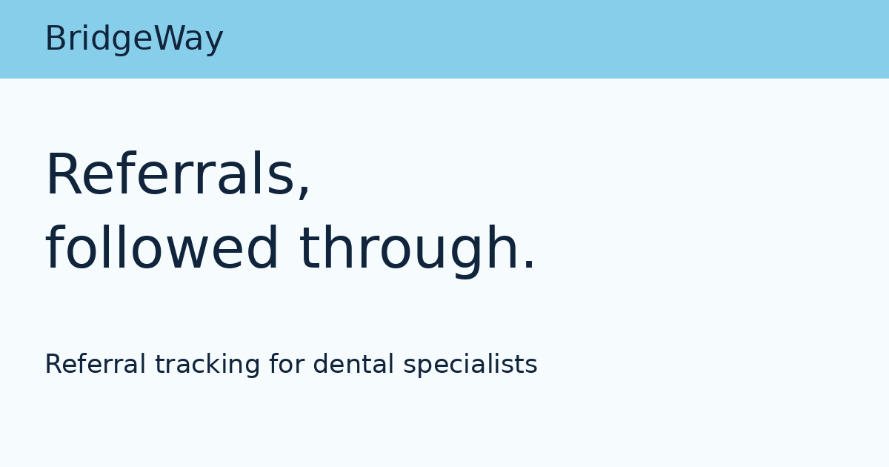

# BridgeWay Refer

BridgeWay Refer helps businesses collect referrals in person and track what happens next. A customer taps an NFC card or scans a QR code to open a short form on their phone. The referral goes straight to the receiving team’s inbox. No app download is required.

[Visit the website](https://bridgewayrefer.com/) · [See pricing](https://bridgewayrefer.com/pricing) · [Sign in](https://bridgewayrefer.com/sign-in)

## How it works

BridgeWay is built for referral-driven teams, including healthcare offices and home service businesses.

## What teams can do

- **Collect referrals.** Give partners NFC cards or QR codes that open a branded form on any phone.
- **Manage follow-up.** Assign referrals, update statuses, and see who owns the next step.
- **See where referrals come from.** Track activity by partner and location.

## License

All rights reserved.
