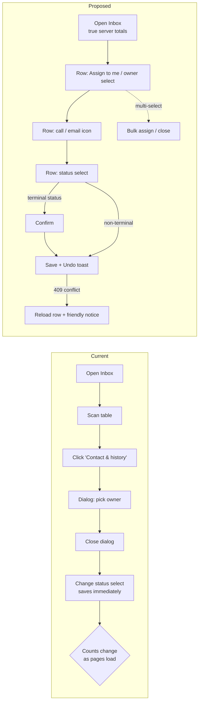
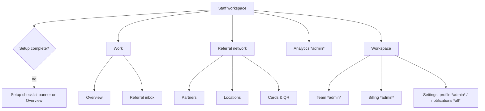
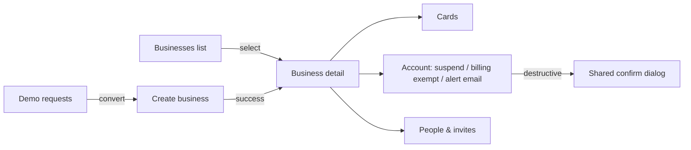
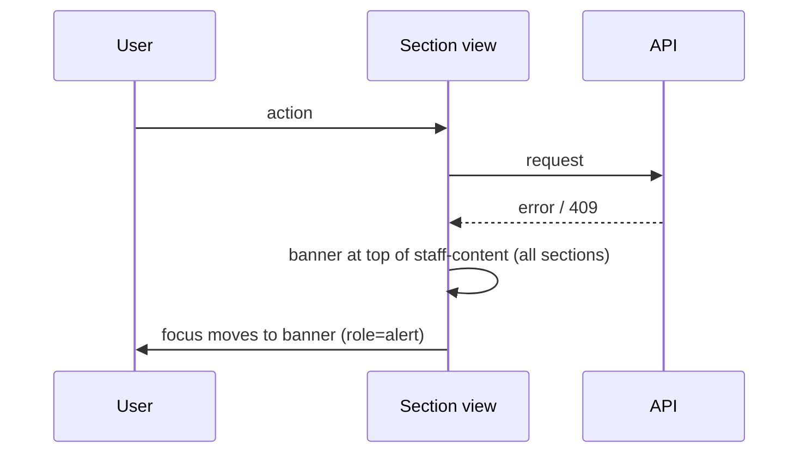

# Staff & Admin Dashboard — UX Review and Implementation Plan

Date: 2026-11-18 · Scope: `components/StaffDashboard.tsx`, `components/AdminConsole.tsx`, `app/staff.css`, `app/globals.css` · Status: **plan only, no code changed**

Constraint: keep current branding (Faustina type, `--navy #0D2339`, `--accent #48B2E6`, `--sky`, `--offwhite`, amber accents, logo assets). Changes below adjust structure, sizing and semantics, not the palette.

---

## 1. Findings

### A. Broken / fragile text rendering
| # | Issue | Where |
|---|---|---|
| A1 | Mojibake was fixed in PR #51, but non-ASCII glyphs are still inlined as literals (`…`, `·`, `→`, `↻`, `↗`, `✓`, `☰`, `—`). Any re-save in a non-UTF-8 editor (the untracked `build-error.txt` is UTF-16, showing the Windows toolchain does this) will garble them again. | Both components |
| A2 | `build-error.txt` reports "Expression expected" at `StaffDashboard.tsx:421`; the file is now 420 lines, so it is probably stale, but there's no guard against a recurrence (no encoding check in CI). | `src/bridgeway-web/build-error.txt` |
| A3 | Text is too small to read: 8–11px text in many places (`.eyebrow` 8–9px, `.metric` 9px, `.chart-footnote` 9px, `.staff-referral-status` 11px, `.doctor input` 10px). Inputs under 16px also make iOS zoom in. | `app/staff.css:86-97,195,202` |
| A4 | Times appear in three different formats: "MT" hard-coded (`America/Denver`) in details/history, browser-local `toLocaleString()` for follow-up due times, and "UTC" for filter dates. | `StaffDashboard.tsx:380,396-399,384` |
| A5 | Arrows are put inside button text ("Refresh inbox ↻", "Send test alert ↗"), so screen readers read the symbol names aloud. | `:381,:416` |

### B. Layout inconsistencies
| # | Issue |
|---|---|
| B1 | Staff uses a sidebar shell (`staff-shell`) while Admin uses the older `dashboard` + tab-button layout. The two consoles look like separate products. |
| B2 | The error/notice banners (`:369`) render **below** the Overview section, so on Overview an error shows up below the fold. On other sections they render above the content. |
| B3 | The "Refresh analytics" button sits outside any card or heading (`:405`). |
| B4 | "Partners and locations" and "Cards" share one card with the same NFC instructions. The Cards view has no add/deactivate controls, while Admin's card view has them. |
| B5 | The referral detail `<dialog>` is styled inline and rendered **inside a `<tr>`**, which is invalid table content and causes layout and focus quirks. |
| B6 | Settings shows "Business profile" only to admins, but non-admins still see the Settings nav item and only get the Email alerts card. |
| B7 | `window.scrollTo(0,0)` runs on every section change, including the first load. The 11 blank lines at `:283-292` are leftover clutter. |

### C. Accessibility (WCAG 2.1 AA)
| # | Issue |
|---|---|
| C1 | **Contrast risk:** `--navy-deep` and `--accent-strong` are both `#7BC8ED` (light blue). Anywhere they're used as text or a button background with white text, contrast is about 1.9:1. Needs an audit of usage. |
| C2 | Sidebar links override their visible text with a different `aria-label` ("Referral inbox" is announced as "Referrals", "Office report" as "Analytics"), which fails WCAG 2.5.3 Label in Name. "Cards" reuses the `management` icon and "Settings" reuses the `setup` icon. |
| C3 | The always-mounted `role="alert"` and `role="status"` paragraphs are fine. But `aria-live` on the metric grid announces every refresh, which is noisy. |
| C4 | Opening the detail dialog with `showModal()` inside a ref callback means focus is never returned to the "Contact & history" trigger when it closes. |
| C5 | Changing a status in the `<select>` saves immediately on change. Keyboard users who arrow through options fire a PATCH for each option they pass (on some browsers). |
| C6 | The bar chart is `role="img"` with per-month `aria-label`s on child divs, which an img role ignores. It needs a text or table alternative. |
| C7 | Admin tabs use `aria-current="page"` on buttons with `aria-controls`. This should be either a proper tablist (`role=tab`, `aria-selected`, arrow keys) or real links. |
| C8 | The mobile scrim is a focusable `<button>` with no visible label, and the sidebar has no focus trap while it's open as an overlay. |
| C9 | Destructive actions differ: "Revoke access" asks for confirmation with `window.confirm`, while "Cancel invite", "Deactivate card" and admin "Suspend business" don't ask at all. |

### D. Confusing navigation
| # | Issue |
|---|---|
| D1 | 9 flat nav items for admins: Overview, Referral inbox, Analytics, Setup, Partners and locations, Cards, Settings, Team, Billing. There's no grouping, and Setup (the onboarding task) sits in the middle. |
| D2 | "Platform admin" appears twice (in the sidebar and in the topbar). |
| D3 | Section names don't match: nav "Analytics" vs. hash `office-report`, nav "Setup" vs. "Workspace setup", nav "Team" vs. heading "Staff access", hash `#referrals` silently rewritten to `#inbox`. |
| D4 | Admin: clicking a business name jumps to the "NFC cards" tab, which also holds account controls and People, so the tab label doesn't describe its content. |
| D5 | When no workspace is selected, Overview still renders with "—" metrics above the "Choose a workspace" message. |
| D6 | When intake is paused, the banner text says "Use Subscribe in the Billing section" but gives no link. Staff (non-admin) users can't reach Billing at all. |

### E. Referral inbox usability
| # | Issue |
|---|---|
| E1 | **Counts are wrong.** Status chips and "Needs attention" count only *loaded* pages (labelled "Loaded requests"), so totals change as you click "Load more". |
| E2 | Filters are applied twice: on the server (debounced query) and again client-side in `filtered`. The client-side re-sort then reorders rows already sorted by the server cursor, so paging inserts rows mid-list. |
| E3 | The status chips and the Status `<select>` in Filters control the same state. That's two controls for one filter, and the chips are 9px on mobile. |
| E4 | Owner assignment, follow-up and notes live only in the side dialog. Triage (assign + status) takes 3 clicks per row. There's no "Assign to me". |
| E5 | No bulk actions (assign or close several referrals). |
| E6 | The "Next action" column mixes a status word ("Completed") with instruction text. Overdue only shows as a badge in the name cell, with no due date in the row. |
| E7 | Changing a status has no undo and no confirmation for terminal statuses (Won/Closed). Optimistic concurrency failures (etag) only show the generic error banner. |
| E8 | Contact details (phone/email) need two clicks to reach. The primary job, calling the patient, should take one. |
| E9 | The empty state doesn't tell apart "no referrals yet" (link to Setup/test referral) from "filters exclude everything" (offer a "Clear filters" action). |

---

## 2. Prioritized plan

**P0 — correctness and blockers (1–2 days)**
1. Fix inbox counts (E1): have the API return per-status totals for the current query and use them in the chips and in "Needs attention". Drop the "Loaded requests" wording.
2. Remove the client-side re-filter/re-sort (E2). Rely on the server order and add a server sort key for "attention first".
3. Move error/notice banners to the top of `staff-content` for every section (B2).
4. Encoding guard (A1/A2): replace the literal glyphs with HTML entities or CSS (`content:"→"`), add `.editorconfig` (`charset = utf-8`) and `.gitattributes` (`*.tsx text eol=lf working-tree-encoding=UTF-8`), add a CI grep step that fails the build on `Ã|â€|�`, and delete the stale `build-error.txt` and `.backup` files.
5. Contrast fix (C1): repoint `--navy-deep` to a dark value (for example `--navy`) and keep `#7BC8ED` only for fills and decorative use. Brand hues stay the same.

**P1 — accessibility and inbox workflow (3–5 days)**
6. Move the referral detail drawer out of the table into one `<ReferralDrawer>` component. Return focus to the trigger on close and drop the inline styles in favour of CSS (B5, C4).
7. Inline triage in each row: an Owner select with an "Assign to me" shortcut, a click-to-call/mail icon, and a due-date column with the overdue state (E4, E6, E8).
8. Status change: commit on change only after the user confirms terminal states. Show an undo toast for 5s. Show a friendly "someone else updated this referral, reloaded" message on 409/412 (C5, E7).
9. Bulk select with Assign and Close (E5).
10. Two different empty states plus a "Clear filters" action. Remove the duplicate status filter: keep the chips and drop the Status select inside Filters (E3, E9).
11. Make visible labels match aria-labels, give each nav item a distinct icon, and replace the chart with a visually-hidden data table (C2, C6).
12. Raise the type scale minimum to 12px (labels) / 14px (body) / 16px (inputs on mobile) (A3).
13. Use one timezone: show workspace-local time with an explicit zone everywhere, and drop the "UTC" filter labels (convert on submit) (A4).

**P2 — navigation and consistency (3–4 days)**
14. Group the staff nav: **Work** (Overview, Inbox), **Network** (Partners & locations, Cards), **Insights** (Analytics), **Workspace** (Setup*, Team, Billing, Settings). Show Setup at the top as a checklist banner until it's complete, then move it under Workspace (D1).
15. Make nav labels, headings and hash names match (`#analytics`, `#team`, `#setup`) and redirect the old hashes (D3).
16. Show Settings to non-admins as "Notifications" only, and include an admin contact link in the paused-intake banner (B6, D6).
17. Remove the topbar Platform admin duplicate (D2) and hide Overview until a workspace is chosen (D5).
18. Merge Partners/Locations/Cards into one "Referral network" area with sub-tabs; let admins add and deactivate cards there (B4).
19. Admin console: adopt the same `staff-shell` sidebar. Tabs become Businesses, Business detail (Cards · Account · People sub-sections), Create, Leads. Use a proper tablist pattern (B1, C7, D4).
20. Use one confirm-dialog component for all destructive actions (C9).

**P3 — polish**
21. Focus trap and `inert` main content while the mobile sidebar is open. Make the scrim non-focusable (C8).
22. Remove the noisy `aria-live` from metrics. Announce "Inbox updated" once per manual refresh (C3).
23. Split `StaffDashboard.tsx` (420 lines of one-line JSX) into section components so future changes are reviewable (supports all of the above).
24. Add Playwright and axe checks for each section in both roles.

---

## 3. Workflow diagrams

### 3.1 Referral triage — current vs. proposed

### 3.2 Staff navigation information architecture

### 3.3 Admin console flow

### 3.4 Error/notice placement

---

## 4. Verification per phase
- `npm run build` plus Playwright suite for each PR. Add axe-core scans of every section as Admin and as Staff.
- Manual checks: keyboard-only triage of 3 referrals, VoiceOver/NVDA pass through the nav and drawer, 375px-wide viewport, a workspace with more than 50 referrals (pagination counts).
- CI encoding guard must fail on a deliberately garbled fixture before it's trusted.
